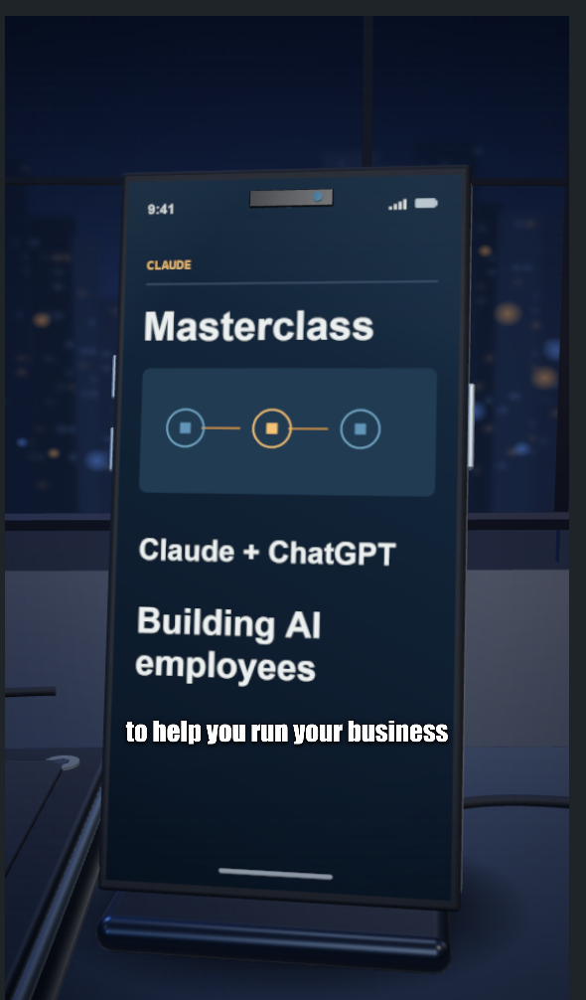

# teng-edit

Put your talking-head takes in a folder and give Codex its path. One `$teng-edit` request edits the dialogue, reuses assets from the local library, builds the missing animations, and captions the finished cut. Review the editable timeline inside Codex.

## Install in Codex

Anyone can install the skill by pasting this into a Codex chat.

> Install the Codex skill at https://github.com/kevintengai/teng-edit/tree/main/skills/teng-edit.

The edit workflow, animation workflow and local style library come in that one install. Python 3.10+, Node.js with npm, and FFmpeg with ffprobe support the local tools. Codex sets up the project’s Remotion dependencies when preparing the first edit.

## Use it

> Use $teng-edit on the footage in this folder. Cut dead space and retakes, keep my natural delivery, use my saved animations where they fit, and open the captioned edit here for review.

> Use $teng-edit on this talking-head recording. Keep my voice underneath the cutaways, animate the product workflow when I explain it, and open the edit here for review.

> Use $teng-edit. Start with me over the animated background, cut to the full-screen demo, then put the demo on top and me on the bottom while I explain the result.

Split screen works with an ordinary camera recording. For a presenter in front of a moving background, use a green-screen take or a clip with transparency. You can resize the upper panel and add a short title across the divider. [See the presenter layouts](skills/teng-edit/references/presenter-layouts.md).

> Use $teng-edit on this voiceover. Build a vertical animated explainer in the midnight-signal style and keep the final invitation on screen through the last word.

> Use $teng-edit to save this revised animation look as a new style, then use that revision for my next video.

## The built-in look

The starter demo looks straight down on a navy proof press. A roller crosses the sheet and leaves a set of amber registration marks behind. The amber headline and cool white supporting line use the bundled Anton typeface. Spoken captions use the same face with a dark edge and amber emphasis on selected words.

Remotion provides the editable timeline. FFmpeg handles media checks when useful. New styles live in a local versioned library and each project pins its chosen look. The creator reviews the current cut before approving a video export.
